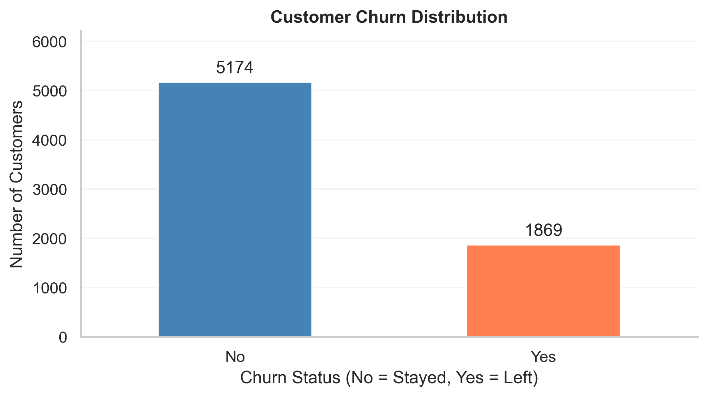
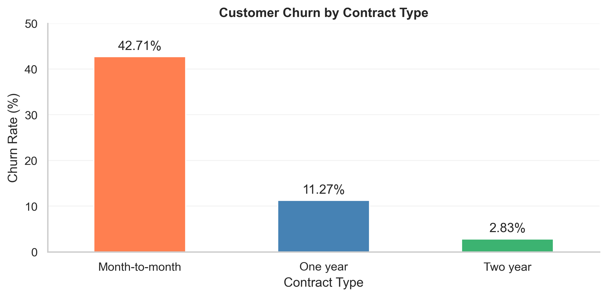
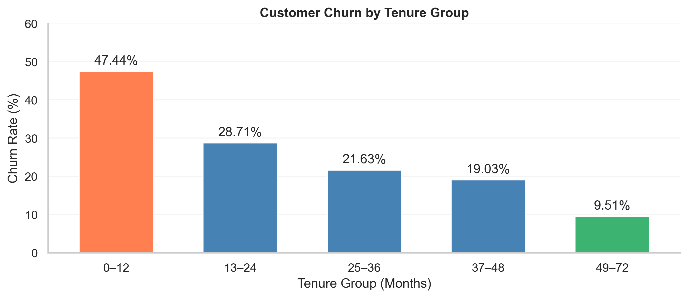
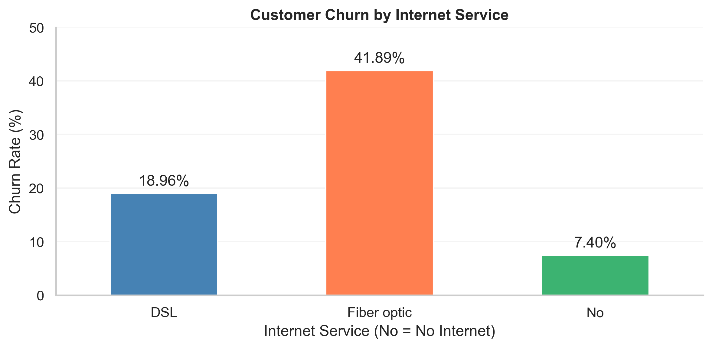
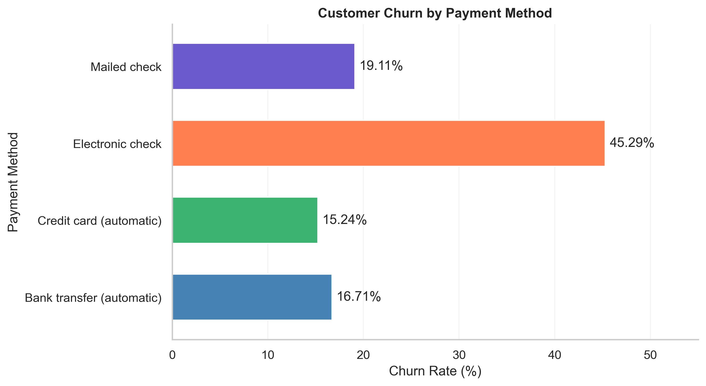
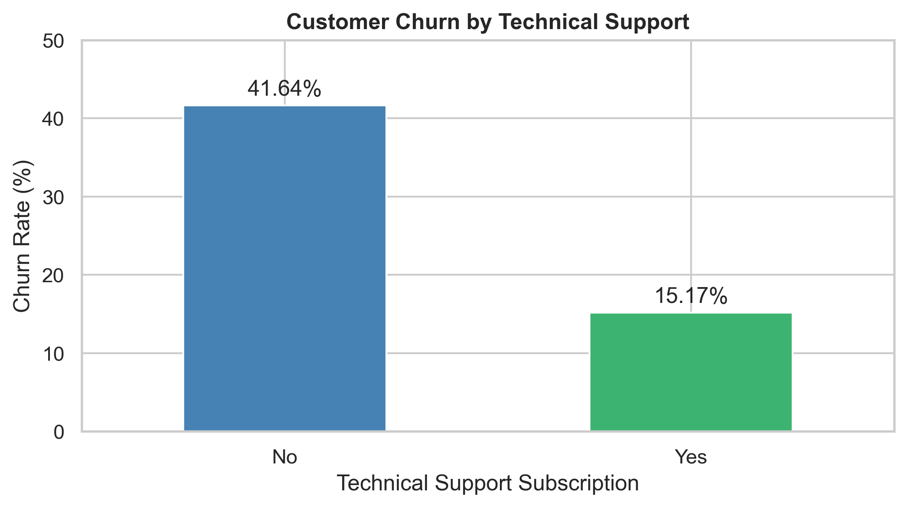
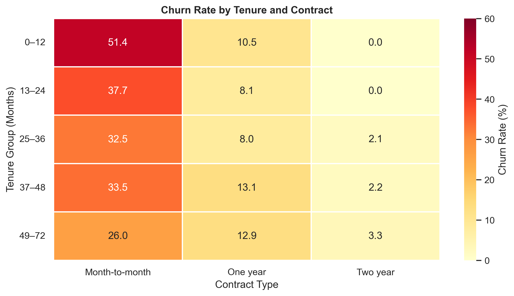
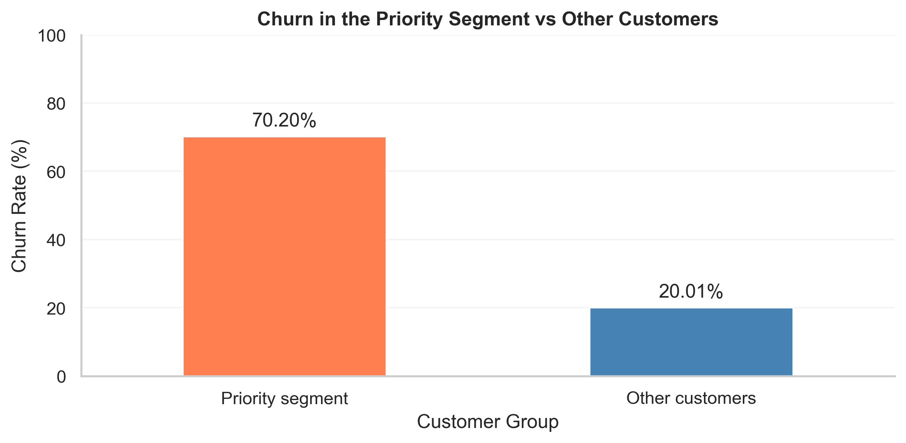
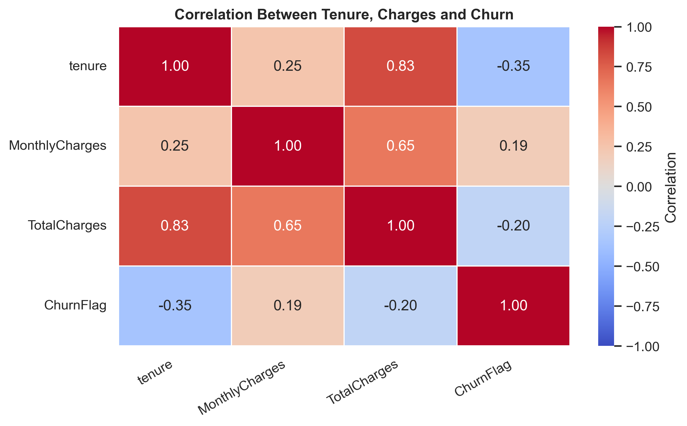

<div align="center">

# 📉 Telco Customer Churn Analysis

### Identifying customer attrition patterns and retention opportunities with Python


*An end-to-end exploratory data analysis project translating customer behavior into practical retention insights.*

</div>

---

## 📌 Project Overview

Customer churn affects recurring business relationships and can signal problems with onboarding, pricing, service experience, or customer expectations. This project explores a telecommunications customer dataset to compare **churn across contract types, customer tenure, internet services, payment methods, and optional services**.

The notebook covers data inspection, cleaning, descriptive analysis, visualization, segment identification, and business recommendations. The findings are **associations, not evidence of causation**.

## 🎯 Business Objective

Identify customer groups with elevated churn rates, investigate possible retention priorities, and develop testable recommendations for improving customer experience and retention.

## 📊 Dataset at a Glance

| Metric | Value |
|---|---:|
| Customers | **7,043** |
| Original columns | **21** |
| Churned customers | **1,869** |
| Retained customers | **5,174** |
| Overall churn rate | **26.54%** |
| Missing `TotalCharges` | **11**, all with zero tenure |
| Duplicate records / customer IDs | **None found** |

**Data preparation**
- Converted `TotalCharges` from text to numeric, leaving 11 unavailable values as missing rather than inventing amounts.
- Created a binary `ChurnFlag` and tenure categories for comparison.
- Relabeled the senior-citizen indicator for readability.
- Preserved separate “No internet service” and “No phone service” categories.
- Used each segment’s customer count as the denominator for its churn rate.

> **Dataset note:** The supplied CSV is the Telco Customer Churn dataset. Verify the original publisher and redistribution terms before sharing the CSV publicly.

---

## 🔍 Key Findings

<details open>
<summary><strong>1. Overall customer churn is 26.54%</strong></summary>



Of **7,043** customers, **1,869** are labeled as churned and **5,174** as retained.

**Business takeaway:** This is the baseline against which segment-level churn rates can be compared.
</details>

<details open>
<summary><strong>2. Month-to-month contracts have much higher churn</strong></summary>



| Contract | Churn rate |
|---|---:|
| Month-to-month | **42.71%** |
| One year | 11.27% |
| Two year | 2.83% |

**Business takeaway:** Investigate whether appropriate, optional longer-term plans and improved onboarding could help reduce churn. These comparisons do not show that switching contract type itself would prevent churn.
</details>

<details open>
<summary><strong>3. Newer customers are especially vulnerable</strong></summary>



Customers with **0–12 months** of tenure have a **47.44%** churn rate, compared with **9.51%** among those with **49–72 months**.

**Business takeaway:** Prioritize first-year onboarding, early support, and billing clarity for investigation.
</details>

<details open>
<summary><strong>4. Fiber optic customers show higher observed churn</strong></summary>



| Internet service | Churn rate |
|---|---:|
| Fiber optic | **41.89%** |
| DSL | 18.96% |
| No internet service | 7.40% |

**Business takeaway:** Review fiber service quality, pricing, and customer feedback before deciding on interventions.
</details>

<details open>
<summary><strong>5. Electronic check customers have the highest churn by payment method</strong></summary>



| Payment method | Churn rate |
|---|---:|
| Electronic check | **45.29%** |
| Mailed check | 19.11% |
| Bank transfer (automatic) | 16.71% |
| Credit card (automatic) | 15.24% |

**Business takeaway:** Investigate payment friction and billing experience. Payment method may correlate with other customer characteristics.
</details>

<details open>
<summary><strong>6. Online security and technical support are associated with lower churn</strong></summary>




Among customers with internet service, subscribers to these add-ons show lower observed churn than non-subscribers.

**Business takeaway:** Explore unmet security and support needs; these associations do not prove that adding a service will prevent churn.
</details>

<details open>
<summary><strong>7. Contract type and tenure together reveal important differences</strong></summary>



**Business takeaway:** Evaluate multiple customer characteristics together rather than relying on one variable in isolation.
</details>

<details open>
<summary><strong>8. A focused priority segment accounts for 34.40% of churn</strong></summary>



The identified segment comprises **first-year, month-to-month fiber optic customers**.

| Metric | Result |
|---|---:|
| Customers in priority segment | **916** |
| Churned within segment | **643** |
| Segment churn rate | **70.20%** |
| Churn rate among other customers | **20.01%** |
| Share of all churn from segment | **34.40%** |

**Business takeaway:** This is a useful candidate for a targeted retention trial, but the segment was identified using the same dataset and should be validated on new data.
</details>

---

## 📈 Additional Exploratory Visual

### Correlations between numerical features



The heatmap summarizes linear relationships among tenure, monthly charges, total charges, and churn status. Correlation should not be interpreted as causation.

## 💡 Business Recommendations

1. **Improve first-year onboarding:** Review installation follow-ups, early support, and first-bill communication.
2. **Investigate fiber optic experiences:** Examine complaints, network performance, and plan value.
3. **Test optional contract alternatives:** Evaluate whether suitable longer-term plans improve retention in controlled trials.
4. **Reduce billing friction:** Investigate electronic-check payment difficulties and billing confusion.
5. **Review support and security needs:** Understand customer needs before promoting add-on services.
6. **Validate the priority segment:** Test interventions on new customer cohorts and compare outcomes with a suitable control group.

## 🧰 Tools & Technologies

- **Python** — analytical workflow
- **Pandas & NumPy** — cleaning, segmentation, and numerical summaries
- **Matplotlib & Seaborn** — visualizations and heatmaps
- **Jupyter Notebook** — reproducible analysis

## 🗂️ Project Structure

```text
Telco-Customer-Churn-Analysis/
├── Telco_Customer_Churn_Analysis.ipynb
├── WA_Fn-UseC_-Telco-Customer-Churn.csv
├── requirements.txt
├── README.md
└── assets/
    ├── churn_distribution.png
    ├── contract_churn.png
    ├── tenure_churn.png
    ├── internet_churn.png
    ├── payment_churn.png
    ├── security_churn.png
    ├── tech_support_churn.png
    ├── correlation_heatmap.png
    ├── tenure_contract_heatmap.png
    └── priority_segment_churn.png
```

## ▶️ Run the Analysis

1. Clone the repository and navigate to its directory.
2. Install dependencies:

   ```bash
   pip install -r requirements.txt
   ```

3. Open `Telco_Customer_Churn_Analysis.ipynb` in Jupyter Notebook or VS Code.
4. Ensure the CSV filename and path in the notebook match the file in this repository.
5. Run the notebook cells sequentially.

## ⚠️ Limitations

- The dataset has no customer acquisition or churn dates, so month-by-month churn trends cannot be reliably calculated.
- Complaints, network quality, competitor offers, and satisfaction scores are unavailable.
- Eleven `TotalCharges` values are missing; these customers are excluded only from calculations requiring that field.
- Some segments may be small, and differences may reflect confounding factors.
- The priority segment was chosen after exploring the dataset and needs out-of-sample validation.
- Combined monthly charges are not verified lost revenue, profit, or guaranteed retention savings.
- The dataset's collection period and currency are not documented in the supplied file.
- This is exploratory analysis, not a trained churn-prediction model.

## 🚀 Future Improvements

- Build a Power BI dashboard for interactive churn monitoring.
- Develop and validate a churn prediction baseline.
- Incorporate customer satisfaction, complaints, and service-performance data.
- Evaluate retention interventions through controlled experiments.

## ✅ Conclusion

The analysis identifies **newer month-to-month customers, particularly fiber optic subscribers**, as a useful starting point for retention research. Contract type, tenure, internet service, and payment method all show meaningful differences in observed churn. The next step is to validate these patterns with fresh data and test targeted improvements to onboarding, billing, and support.

---

<div align="center">

**Skills Demonstrated:** Data Cleaning · EDA · Customer Segmentation · Data Visualization · Statistical Interpretation · Business Recommendations

**Divya Dande** · [LinkedIn](https://www.linkedin.com/in/dande-divya-504bb2225/)

</div>
